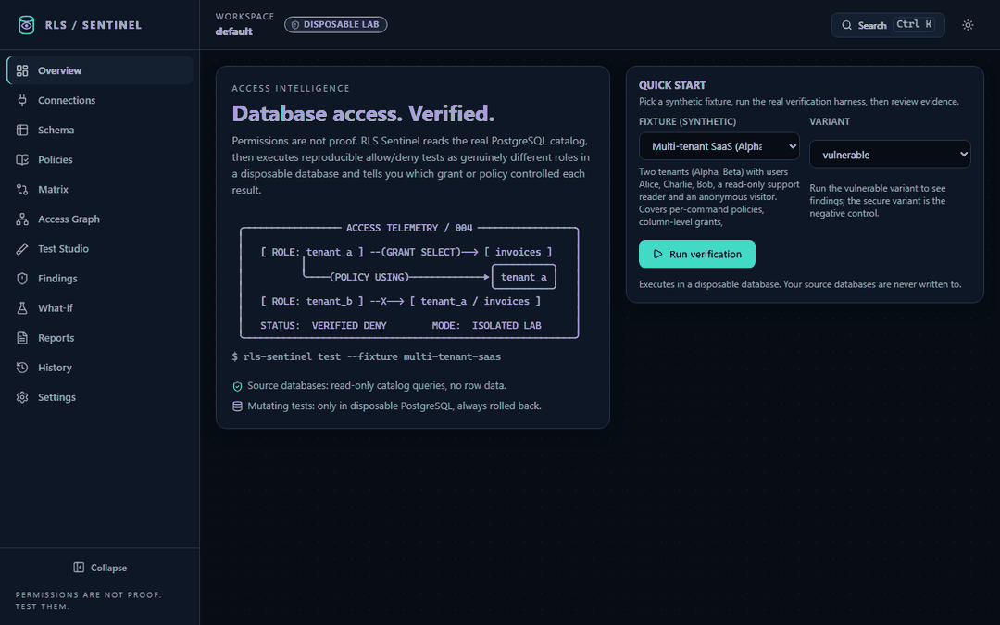
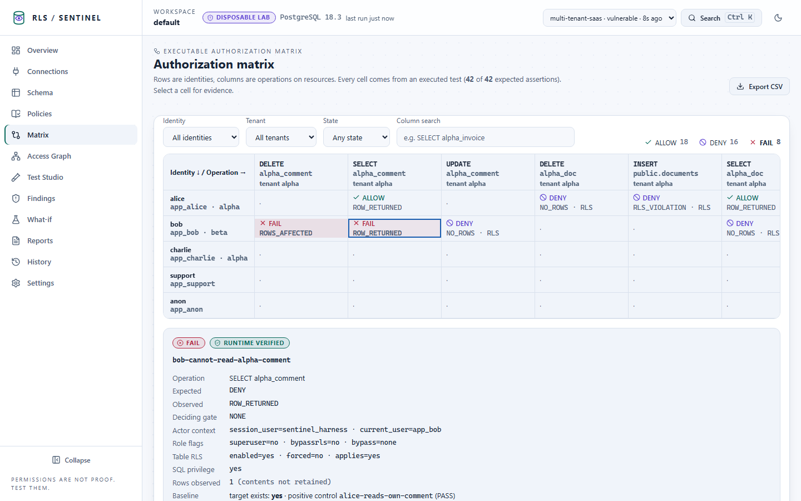
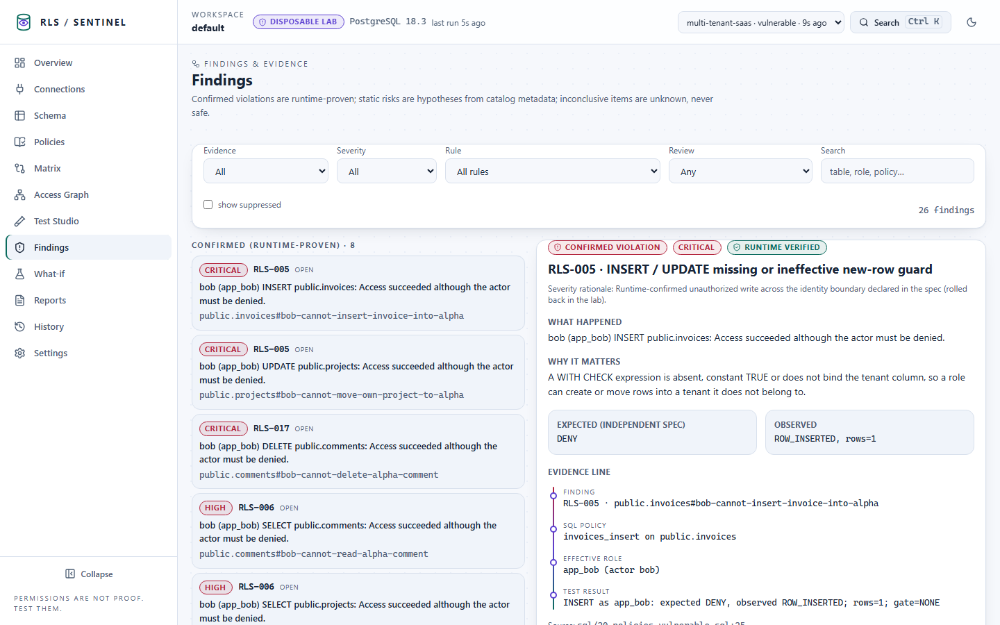
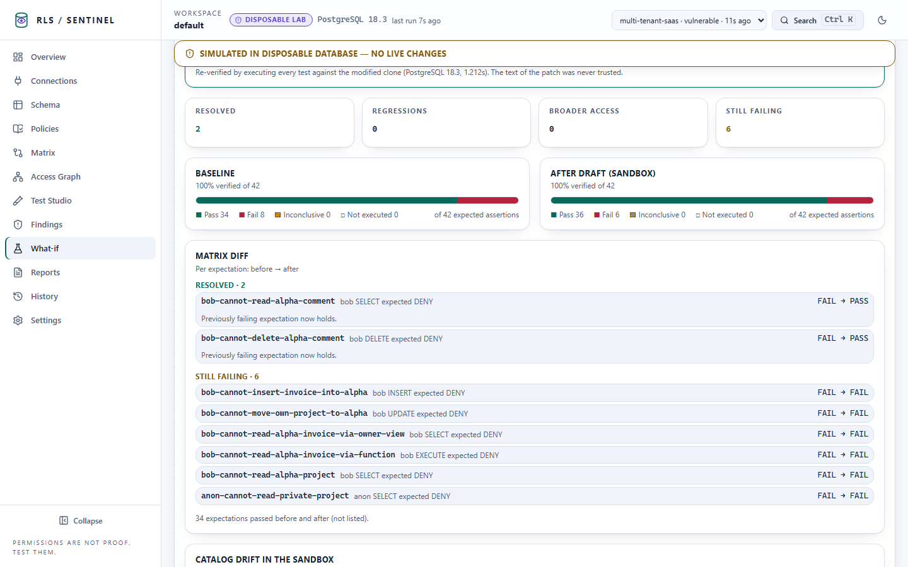
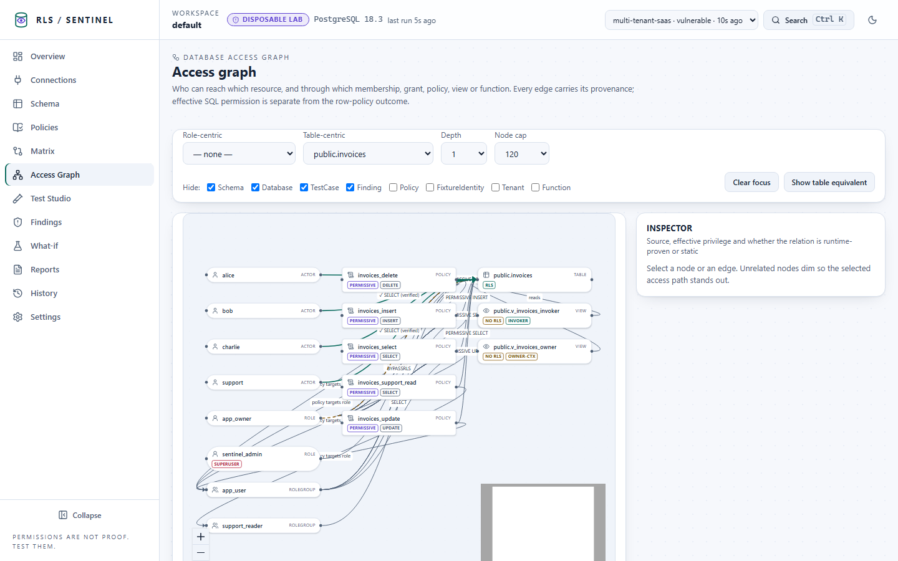
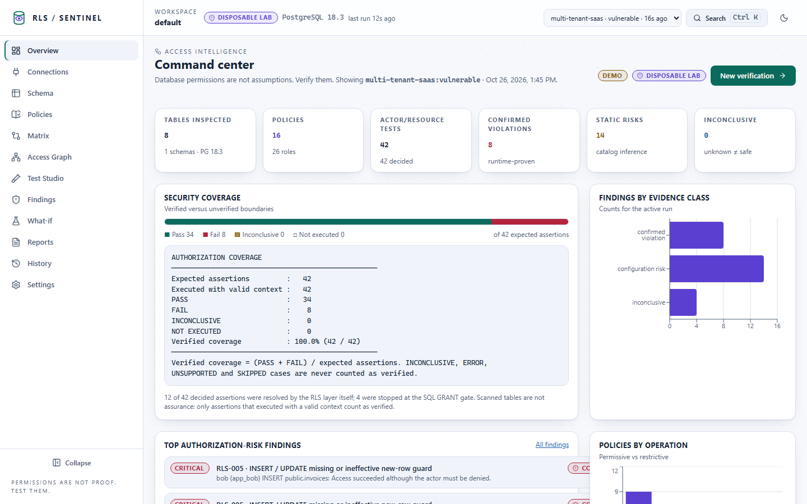

# RLS Sentinel

**Database access. Verified.** · [Русская версия](README.ru.md)

RLS Sentinel checks whether your PostgreSQL Row-Level Security policies actually do what you expect. It does not
only read policy text. It **executes** an authorization matrix (who may read / insert / update / delete which rows, as
which database role) inside a disposable PostgreSQL instance and tells you, per case, what PostgreSQL really did,
with evidence. Anything it cannot prove is reported as `INCONCLUSIVE` or `UNSUPPORTED`, never as safe.

> **Permissions are not proof. Test them.**

<p align="center">
  
  <br><sub>A real run of the bundled synthetic fixture, recorded from the UI (25 s, no cuts in the data).</sub>
</p>

| | |
|---|---|
|  |  |
| **Command center**: real counts and verified coverage | **Matrix**: every cell is an executed test; the evidence names the deciding gate |
|  |  |
| **Finding**: expected vs observed, why it matters, reproduction | **What-if**: a draft fix replayed in a clone, diffed case by case |
|  |  |
| **Access graph**: roles, policies, tables, with provenance | **Light theme** with WCAG AA contrast |

## What it does

| Capability | How |
|---|---|
| **Behavioural tests** | Every expectation in a YAML spec becomes a real SQL statement run as `SET LOCAL ROLE <actor>` inside a transaction that is always rolled back. The harness login is a non-superuser, `NOINHERIT`, non-`BYPASSRLS` role. |
| **Evidence, not opinions** | Each case records the deciding gate (SQL `GRANT` vs RLS), applicable policies, role flags (superuser / `BYPASSRLS` / owner / `FORCE`), SQLSTATE and a masked row indicator. Row contents are never retained. |
| **Catalog audit of a live database** | `rls-sentinel scan` reads `pg_catalog` through a read-only session: no DDL, no DML, no row data. 21 rules (RLS-001…021) produce static findings that are always labelled *inference*, never *confirmed*. |
| **Authorization matrix and access graph** | Identities × operations × resources built only from executed cases; a typed graph of roles, memberships, grants, policies, views and functions with per-edge provenance. |
| **What-if Policy Lab** | Replay a draft policy change in a disposable clone, then diff the whole matrix: resolved, regressions, broader access. Drafts pass an AST allow-list; nothing is ever applied to a source database. |
| **Reports** | JSON, Markdown, HTML, CSV and **SARIF 2.1.0** (validated against the official schema), plus a generated pytest regression suite. |
| **Drift** | Compare two snapshots or runs; policy-level semantic diff with risk direction. |


## Quick start

Requires Python 3.12+ and a PostgreSQL 15+ installation (only its binaries are used, to start a throwaway cluster)
**or** Docker.

```bash
python scripts/build_release.py                          # builds the UI and a wheel into dist/ (needs Node 22+)
pip install dist/rls_sentinel-1.0.0-py3-none-any.whl
rls-sentinel demo up                                     # local UI on http://localhost:8787, bundled synthetic fixtures
```

The package is not published to PyPI by this repository; release assets (wheel, sdist, checksums, SBOM) are produced
by the release workflow.

Command line, no UI:

```bash
rls-sentinel fixtures list
rls-sentinel test --fixture multi-tenant-saas --variant vulnerable --format html -o report.html
echo $?    # 1: confirmed violations were found
rls-sentinel test --fixture multi-tenant-saas --variant secure --format sarif -o results.sarif
echo $?    # 0
```

Docker Compose (API + UI + metadata database + a hardened, internal, disposable fixture database):

```bash
python scripts/make_env.py          # writes .env with random secrets (never committed)
docker compose up --build
# open http://127.0.0.1:8787 and paste SENTINEL_API_TOKEN from .env into the Unlock dialog
```

## The bundled fixtures

All data is synthetic. Each fixture has a `vulnerable` variant with documented defects and a `secure` variant used
as a negative control (it must produce zero confirmed violations).

| Fixture | Shows |
|---|---|
| `multi-tenant-saas` | per-command policies, column grants, default-deny, `security_invoker` vs owner views, `SECURITY DEFINER` |
| `policy-precedence` | permissive vs restrictive, `PUBLIC`, owner bypass vs `FORCE`, `BYPASSRLS`, restrictive-only table |
| `saas-auth-context` | Supabase-style `auth.uid()` / claims (synthetic identity, labelled as such) |
| `external-benchmark` | the `passwd` example from the PostgreSQL documentation, expectations taken from the docs |

Measured agreement with the documented expectations on PostgreSQL 15, 16, 17 and 18 is in
[docs/benchmarks.md](docs/benchmarks.md), together with a scale test: a generated schema of 1 000 tables, 10 000 policies
and 4 000 behavioural cases runs end to end in about 27 s on one machine and finds exactly the 65 planted violations. It is a consistency check on small synthetic schemas, **not** a detection rate.

## Using it on your own schema

1. Write a fixture directory: your schema and policies as SQL, a synthetic seed, and an expected-policy spec
   (see [docs/authorized-testing.md](docs/authorized-testing.md)). Run it with `--fixture ./my-fixture --trust-fixture`
   (it executes as superuser in the disposable server, so only run SQL you wrote or reviewed).
2. For a live database you are **authorised** to audit, create an unprivileged inspector login and run
   `rls-sentinel scan --connection-env SOURCE_DSN --allow-target db.internal` for a read-only catalog audit.

The tool never runs behavioural tests against a source database. That is by design, not a missing feature.

## Honest limits

- A result describes the *tested schema in a disposable database*, using PostgreSQL roles. It is not evidence about
  your application's authentication, your connection pooler, or whether clients can forge session settings.
- Coverage is `(PASS + FAIL) / expected assertions`. Operations you did not write an expectation for are not covered;
  the product says so instead of reporting 100%.
- Static findings are inference from catalog text and may be false positives or negatives.

Full list: [docs/limitations.md](docs/limitations.md).

## Documentation

[Architecture](docs/architecture.md) · [Threat model](docs/threat-model.md) · [PostgreSQL RLS semantics used](docs/postgres-semantics.md) ·
[Evidence model](docs/evidence-model.md) · [Authorized testing](docs/authorized-testing.md) · [CLI](docs/cli.md) · [HTTP API](docs/api.md) ·
[Design system](docs/design-system.md) · [Benchmarks](docs/benchmarks.md) · [Limitations](docs/limitations.md) · [Development](docs/development.md)

## Security

See [SECURITY.md](SECURITY.md). Report vulnerabilities privately through the repository's security advisory feature.

## License

[MIT](LICENSE)
